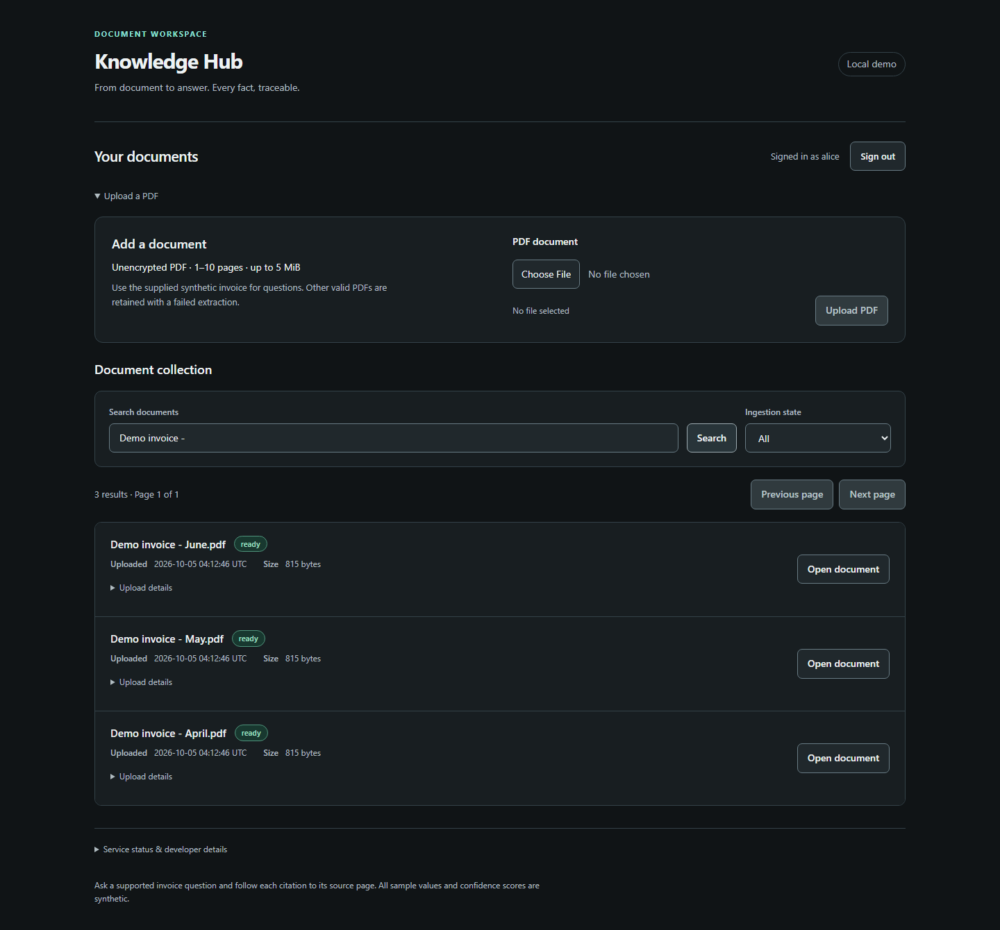
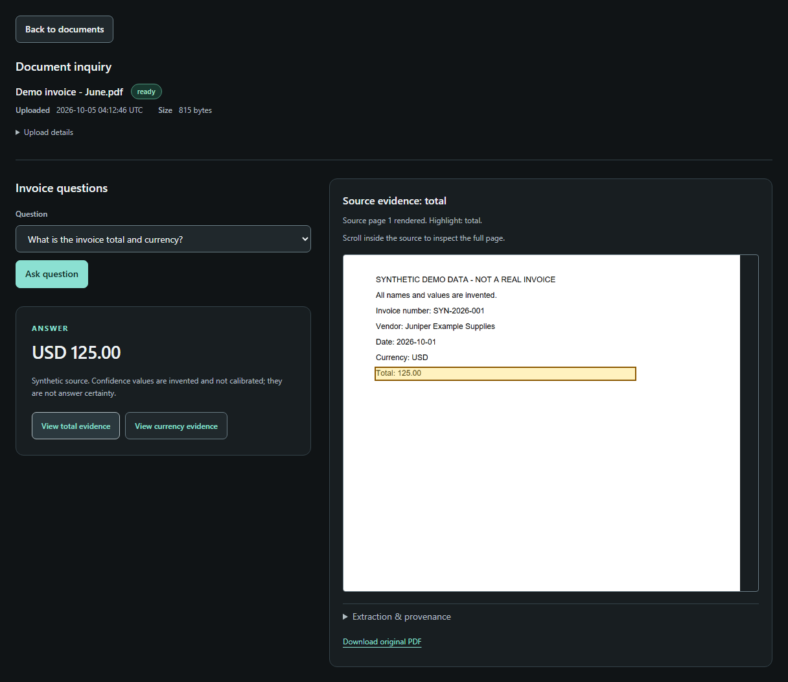

# Knowledge Hub

Functional demo. A document workspace for asking precise invoice questions and checking the evidence behind every answer. Upload the supplied demo invoice, find it in your collection, and follow a citation to the highlighted region on the original page.

Deterministic synthetic extraction makes the demo reproducible and exposes the complete path from authenticated upload to inspectable evidence.


*Find documents by filename or upload ID, filter by ingestion state, and open an individual upload.*


*Each answer links to source evidence; extraction identifiers and coordinates remain available in a provenance disclosure.*

## What it demonstrates

- **Authentication and ownership:** Keycloak OIDC sign-in, opaque server-side sessions, CSRF protection, and owner checks for document metadata, answers and source bytes.
- **A traceable data model:** SQLite stores document identity, extracted fields and relationships. Answers retain field-level provenance, page coordinates, method and confidence metadata.
- **Private source storage:** Original PDFs live in S3-compatible storage and reach the browser through authenticated application routes.
- **A usable investigation flow:** Bounded search and paging, independent upload identities, preserved collection context on return, and PDF rendering with coordinate-based highlights.
- **Failure handling:** Explicit pending, unsupported-document and dependency-unavailable states, plus integration and real-browser tests for isolation, stale responses and recovery.

## Architecture and stack

| Layer | Implementation |
| --- | --- |
| Interface | Next.js 16, React 19, TypeScript, plain CSS |
| Source viewer | PDF.js canvas rendering |
| Demo context and event layer | @borwood/demoable-react 0.1.0 |
| API | Python 3.13, FastAPI, Strawberry GraphQL |
| Identity | Keycloak, OIDC authorization code flow |
| Persistence | SQLite metadata/provenance, SeaweedFS S3-compatible object storage |
| Local runtime and checks | Docker Compose, pytest, HTTPX, Playwright Chromium |

The browser uses a same-origin Next.js proxy. The Python API validates the session and upload, stores the original PDF, and records extraction provenance. GraphQL answers resolve supported questions from those stored facts. Selecting a citation fetches the authenticated original PDF and highlights the stored bounding box. No model or cloud extraction service is called.

See [ingestion and authentication](docs/ingestion.md), [answers and source navigation](docs/questions.md), and [collection behavior](docs/discovery.md) for deeper technical details.

## Path to a hosted service

Knowledge Hub is a local functional demo. Its containers, S3-compatible storage, OIDC flow and provenance model provide foundations for an AWS version. The following is a proposed adaptation path; cloud integrations and deployment are not implemented.

- **Application hosting:** Publish the Next.js and FastAPI images to Amazon ECR and run them on ECS Fargate behind an Application Load Balancer with HTTPS certificates from AWS Certificate Manager. Configure private networking, health checks and the public application origin.
- **Storage and persistence:** Replace SeaweedFS with private Amazon S3 buckets and KMS encryption. Adapt the storage client, which currently requires a local endpoint and explicit credentials, to use IAM task roles with scoped permissions. Move SQLite metadata and provenance to RDS PostgreSQL through schema/data migrations and database-access changes.
- **Identity:** Adapt OIDC sign-in to Amazon Cognito. The current Keycloak-specific endpoints and fixed client configuration require changes, along with HTTPS cookies, redirects, logout and migration of issuer/subject identities while preserving document ownership.
- **Real invoice extraction:** Replace the deterministic, exact-hash fixture adapter with Amazon Textract's asynchronous invoice analysis: [StartExpenseAnalysis](https://docs.aws.amazon.com/textract/latest/APIReference/API_StartExpenseAnalysis.html) for S3 inputs and [GetExpenseAnalysis](https://docs.aws.amazon.com/textract/latest/APIReference/API_GetExpenseAnalysis.html) for results. Build normalization, persistence and answer validation for real extracted values, raw responses, page geometry and confidence provenance; today's synthetic-only records and checks cannot accept live results unchanged.
- **Durable processing:** Route Textract completion notifications through [SNS and SQS](https://docs.aws.amazon.com/textract/latest/dg/async-analyzing-with-sqs.html) to a worker. Persist job state, make submission and result handling idempotent, and handle retries, partial results and terminal failures without losing the link to the owner's source document.
- **Operations and validation:** Add Secrets Manager, CloudWatch logs/metrics/alarms, backups with restore checks, and automated deployment with rollback. Before hosted use, test representative live extraction, authentication, owner isolation and worker/dependency recovery.

This path preserves the bounded invoice questions and owner-isolated evidence workflow. Broader document understanding and generative answers are separate extensions; synthetic demo confidence does not establish live extraction quality.

## Run locally

Prerequisites: Docker Desktop with the Linux engine running and Compose v2, plus Python 3.13. Initial builds need internet access for locked dependencies and container images.

From the repository root:

```text
python scripts/setup_local.py
docker compose up -d --build --wait --wait-timeout 120
```

Open **http://127.0.0.1:3000**. Use `127.0.0.1` consistently for the browser and identity-provider redirects.

Setup creates an ignored `.env` with random local credentials, preserving any existing values. Enable demo inspection, then hover **Sign in with Keycloak** to reveal the configured **demo-only Alice and Bob usernames/passwords** in its inspection context. Pin the context with its **?** control to select or copy a password; the pin also supports keyboard and touch. Credentials and demo sign-in instructions appear only in the demo layer, and are fetched only when that context opens. These two intended local demo passwords are supplied at runtime through a no-store response; other secrets are not displayed. Keep `.env` private; [`.env.example`](.env.example) documents its keys. Existing identity/storage volumes keep their credentials—editing `.env` alone does not rotate them. The realm imports only on first startup.

### Try the workflow

1. Enable demo inspection and hover or pin the login component to find Alice's credentials. Sign in with Keycloak, then choose **Upload demo invoice**. The app supplies `invoice.pdf` automatically; no local file selection is needed.
2. Choose **Open uploaded document**, or find it in **Document collection** and choose **Open document**.
3. Ask for the invoice total and currency, or the vendor. Choose an evidence link to inspect the highlighted original page; expand **Extraction & provenance** for the underlying identifiers and coordinates.
4. Use **Back to documents** to restore your search, page, scroll position and focus. A full refresh starts a new collection view; stored uploads remain.
5. Sign out, confirm Keycloak logout, then sign in as Bob. Alice's uploads are absent. Uploading the same file creates Bob's own independent document.

The button fetches a public copy of [`fixtures/invoice/invoice.pdf`](fixtures/invoice/invoice.pdf), then sends its exact bytes through the authenticated multipart upload API. Each completed click creates a genuine owner-scoped upload. An integration hash check guards the public asset against fixture drift. If fetching the sample fails, nothing is submitted and the action can be retried.

The API still accepts an unencrypted PDF, at most **5 MiB and 10 pages**. Only the exact supplied sample supports extraction. A different valid PDF is retained with a failed extraction (`UNKNOWN_FIXTURE_DOCUMENT`); the app does not invent facts for it. All sample names, values and confidence scores are synthetic, and confidence is not answer certainty. See the [fixture contract](docs/fixture-contract.md).

### Inspect the demonstration

On desktop, choose **Enable demo inspection** in the app header or press **?** outside editable fields. The optional frame explains the upload → question → evidence walkthrough. Hover a component or pin its **?** marker to read engineering context; pinned explanations support links and expandable details. The settings gear independently switches component explanations and the event log. Use **Disable demo inspection** or **?** to return to the normal workspace without resetting the current document, answer or source. On a primary touch device, the frame starts active; use settings to choose which layers to show.

Upload the sample, ask a supported question, then select a citation. The log reports actual upload, question, source retrieval and PDF render outcomes, including rejection, failure and abandoned work. Retries create new attempts. Aborting a browser upload cannot guarantee that server-side persistence was undone; check the collection before retrying.

Events are in-memory only: successful outcomes expire after 30 seconds, failures after 60 seconds and cancellations after 10 seconds, including while the layer is hidden. Entries can also be dismissed. Summaries omit filenames, document values, identifiers and credentials; there is no remote telemetry or persistent history. The package is pinned locally in `frontend/`—a global installation is not a build dependency. The layer is included in production builds; scenario-changing controls and build-time exclusion are not implemented.

### Stop, resume and troubleshoot

```text
docker compose ps
docker compose logs --tail 50 api web
docker compose stop
docker compose start
```

Stop/start and `docker compose down` preserve the named data volumes. `down --volumes` deletes local data. The app's **Service status & developer details** disclosure exposes dependency health and a connection check; its inspection context contains API examples. If startup fails, check Docker, port conflicts and API logs. Readiness returns HTTP 503 during dependency failure; liveness remains available.

Only loopback ports are published: web 3000, API 8000, S3 8333, and Keycloak 8080. This is a local demonstration with a development-mode identity provider, not a deployed production service. No cloud resources or CI deployment are included.

## Validate

[Development and testing](docs/development.md) covers the host environment and complete commands. With test dependencies and Chromium installed:

```text
python scripts/check_frontend.py
python -m pytest tests/integration tests/e2e -q
```

These checks build the frontend with TypeScript validation and exercise the real Compose runtime, including authorization, persistence, dependency recovery, browser navigation, PDF evidence and accessible dark presentation. Tests briefly interrupt services and leave synthetic acceptance uploads, so run them while the demo is idle. They preserve existing data volumes.
