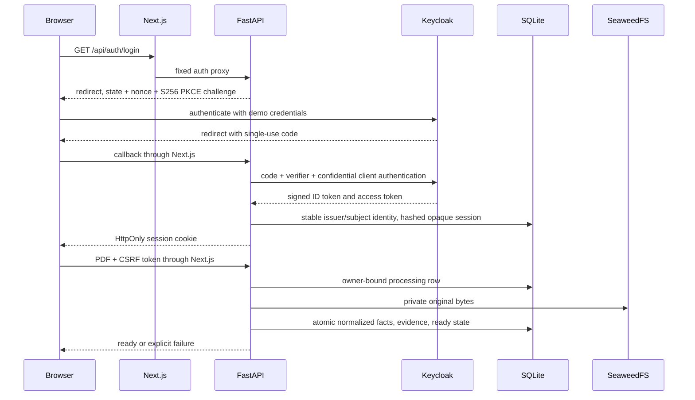

# Authenticated ingestion demo

Keycloak authenticates the person. FastAPI authorizes access to each document. A valid login alone never grants access to another owner's rows or source objects.



## Local setup and authentication

Run `python scripts/setup_local.py` then `docker compose up -d --build --wait --wait-timeout 180`. Open **http://127.0.0.1:3000**. Two users, `alice` and `bob`, have generated passwords in ignored `.env`. The public issuer is exactly `http://127.0.0.1:8080/realms/hub`; the API reaches the same realm through `http://identity:8080/realms/hub`. Internal routing never changes the expected issuer or disables signature checking. Keycloak 26.8.0 is pinned by digest. Authlib 1.8.0 handles OAuth code/PKCE exchange and RS256 OIDC validation (issuer, audience, nonce, expiration and access-token hash when provided).

The ordinary sign-in entry contains no demo credentials or demo-account instructions. With component inspection enabled, hover the existing Keycloak login anchor to open its demo context; pin it to select/copy a password or use it by keyboard/touch. This context alone fetches and displays the two local demo account pairs. Hiding the layer or disabling component inspection removes the credential context. Next.js supplies only the Alice/Bob pairs from runtime Compose environment variables through `GET /api/demo-credentials` with `Cache-Control: no-store`; unavailable configuration shows a useful error inside the context instead of placeholder credentials. They are not compiled into client assets or added to event content. This local demo display does not expose the OIDC client secret, storage keys or session tokens.

After sign-in, **Upload demo invoice** fetches `/demo-invoice.pdf` and submits it as multipart `invoice.pdf` through the existing authenticated document API. The fixed public sample is byte-identical to the canonical fixture, guarded by an integration hash check. Pending work prevents duplicate submission; one abort signal and generation guard cover both sample retrieval and upload. Cancelling before submission creates no document request; after submission, browser cancellation cannot guarantee the server did not retain the PDF.

Login transactions expire in five minutes and are deleted atomically when used, including failed callbacks. Sessions last at most eight hours **and never beyond the provider ID/access-token validity** (the seeded realm uses 30-minute access tokens). Refresh tokens are discarded; sign in again when expired. The browser receives an opaque HttpOnly, SameSite=Lax cookie. Only its SHA-256 digest, owner, CSRF token and expiry persist in SQLite; provider tokens are discarded after validation. Cookies deliberately lack Secure because this is a loopback HTTP demo. Logout deletes the app session and sends the browser to Keycloak's registered RP logout URL; confirm the provider page to end its SSO session. No ID token is placed in logout URLs. Arbitrary return targets are rejected. App logout/revocation is immediate; provider-side administrative revocation is not polled, so an existing app session can last until its bounded expiry.

Unsafe requests require the canonical `Origin` and the per-session `X-CSRF-Token`. The frontend proxies only the fixed auth/document routes, preserves cookies and status, and sets no-store. The API also sets no-store, no-referrer and nosniff. Access logging is disabled on the API to avoid callback code/query leakage. Health stays public and reports only dependency states. The app session database stores no user password or provider token. SQLite and local Docker volumes still need host access protection.

## API contract

Browser paths start with `/api`; direct API paths below use port 8000. Authenticate through the browser before experimenting in its developer console. Do not paste session cookies or passwords into shared logs.

| Method/path | Result |
| --- | --- |
| GET `/auth/login` | Provider redirect; optional `return_to` accepts only `/` |
| GET `/auth/callback` | Validated code response; app session cookie then home redirect |
| GET `/auth/me` | `{username, csrf_token, expires_at}` (Unix seconds) |
| POST `/auth/logout` | App revocation, expired cookie, `{logout_url}` for provider confirmation |
| POST `/documents` | Multipart single `file` part; 201 with ready/failed document |
| GET `/documents` | Legacy `{documents:[...]}`; [bounded pagination/search/filter contract](discovery.md) when collection parameters are supplied |
| GET `/documents/{id}` | Owner-scoped document metadata |
| GET `/documents/{id}/source` | Original PDF as safe attachment, no-store |
| GET `/documents/{id}/provenance` | Document, normalized/raw extraction, fields, entities and relationships |

Example document (IDs and timestamps are illustrative):

```json
{"id":"opaque-uuid","filename":"invoice.pdf","sha256":"64-hex-characters","byte_length":1024,"state":"ready","error_code":null,"created_at":"2026-10-04T00:00:00+00:00","updated_at":"2026-10-04T00:00:01+00:00"}
```

Input must have a `.pdf` filename and `application/pdf` part MIME type, valid unencrypted PDF bytes, 1–10 pages and at most 5 MiB. Total request streaming is capped at 5 MiB plus 64 KiB multipart envelope before parsing, independent of Content-Length. File reads are separately capped. Extra multipart fields/files are rejected. Filename paths are discarded; remaining printable display text is capped at 180 characters. Object keys always use `documents/{server-generated-uuid}/source.pdf`. Every explicit upload gets a distinct ID, including identical hashes and different owners.

Errors are `{error:{code,message}}`. Missing/expired/revoked app sessions return 401 `UNAUTHENTICATED`; absent and not-owned IDs identically return 404 `NOT_FOUND`. CSRF errors return 403. Malformed multipart is 400, unsupported extension/MIME is 415, oversize is 413; invalid/encrypted/page-limit PDFs are 422. Database/storage dependencies return 503. A structurally valid unknown PDF returns 201 with `state=failed`, `error_code=UNKNOWN_FIXTURE_DOCUMENT`, original source retained, and zero facts. It never borrows sample facts. The exact sample returns the unchanged five normalized fields and raw synthetic blocks. Money remains a decimal string (`"125.00"`).

For an explicit two-user HTTP isolation demonstration, sign in as Alice, run `await (await fetch('/api/documents')).json()` in the console and record one document ID. Sign out, confirm provider logout, sign in as Bob, and request `/api/documents/ALICE-ID`, `/source` and `/provenance` with `fetch`. All return the same 404 response as a made-up ID. Bob's list never includes Alice's document. The browser clears protected content on logout/expiry; the expiry timer uses `/auth/me`'s bound, while ten-second polling detects externally revoked app sessions. Reload restores the session and list from the server.

The result list shows each original filename, upload date/time to the second in **UTC**, readable size (with exact byte count), and full unique **Upload ID**. Newest uploads appear first. Upload confirmation includes the same ID, so repeated uploads named `invoice.pdf` can be distinguished even if their timestamps share a second. Refresh retains the metadata. For browser-only isolation QA, note Alice's new upload ID, sign out and confirm provider logout, then sign in as Bob: that ID must be absent even when Bob already has files with the same name. Existing records and timestamps are preserved; acceptance test uploads remain in the demo accounts.

## Persisted provenance

`PRAGMA user_version=1`; every connection enables foreign keys and a two-second SQLite busy timeout. `identities` uniquely maps `(issuer, subject)` to the internal owner. `login_transactions` and `sessions` use hashed cookie identifiers. `documents` owns source metadata, owner, timestamps and state. `extractions` stores matching normalized/raw JSON from the deterministic adapter. `fields` assigns a stable public UUID to each unchanged field payload, including page, block ID, bounding box, method, confidence and `invented_not_calibrated` confidence kind.

`entities` contains one invoice and one vendor **per document**. `entity_evidence` references invoice_number/date/currency/total for invoice attributes and vendor for the vendor name. `relationships` contains `invoice-issued-by-vendor`; `relationship_evidence` points to the vendor field. Composite foreign keys force every evidence reference and relationship endpoint to stay in its document. Public provenance includes these stable IDs and their field links, for example:

```json
{"entities":[{"id":"invoice-uuid","document_id":"document-uuid","kind":"invoice","attributes":{"total":{"field_id":"total-field-uuid"}}}],"relationships":[{"id":"relationship-uuid","document_id":"document-uuid","kind":"invoice-issued-by-vendor","source_id":"invoice-uuid","target_id":"vendor-uuid","field_ids":["vendor-field-uuid"]}]}
```

Resolve each attribute/relationship field ID against the returned `fields` array. Raw payload includes schema version, document hash, synthetic method and invented-confidence notice. No cross-document entity matching or inferred factual relationships are claimed.

## Failure and recovery

Ingestion validates before creating a row, commits `processing`, puts the exact source bytes, then commits all extraction rows and `ready` in one SQLite transaction. Unknown extraction commits only `failed` while retaining source. A put, extraction or finalization failure attempts to delete the source, rolls back partial facts and marks the row failed where the database is available. The HTTP result is 503 when durability cannot be confirmed; it never reports ready. The browser advises refreshing the list after an uncertain network result before uploading again.

There is one API worker. Before accepting business traffic, initialization reconciles leftover `processing` rows to `failed / INTERRUPTED_INGESTION` and attempts their source cleanup. A database outage at boot leaves liveness available; readiness and business requests retry initialization under a lock after recovery. Successful ready/unknown-source documents are never touched. Source retrieval verifies bounded bytes and SHA-256 before sending the attachment, so storage failures become a truthful 503 before response headers.

SQLite and S3 cannot share a transaction. Simultaneous storage/database failures can leave an orphan object after cleanup fails. A bounded, operator-owned recovery is: stop the API; back up its SQLite volume; inspect only the affected document row and exact `documents/{id}/source.pdf` key; preserve all ready rows and unknown-fixture failed rows; after storage recovers delete only keys for known interrupted/dependency-failed rows; restart the API and re-check the affected ID and health. Never use bucket-wide deletion or infer that an unlisted object is safe to delete while an upload may be active. There is no automated deletion/admin UI in this increment.

## Validation and limits

Run the existing configured checks: `python scripts/check_frontend.py` and `python -m pytest tests/integration tests/e2e -q` after the README environment prerequisites. Missing Docker, provider or Chromium fails visibly. Integration tests use real Keycloak browser login, HTTP, SQLite and SeaweedFS, including restart, isolation, compensation and recovery. A separate isolated HTTP provider harness supplies signed wrong-issuer/audience/nonce/expiry/signature tokens to the actual BFF server; it supplements real provider tests without a production bypass. Browser tests exercise keyboard submission, pending duplicate prevention, ready/error/list refresh, provider logout, second-user isolation, expiry and mobile width. Screenshot output is ignored under `test-results`.

This is local-only development: HTTP, Keycloak development database, two seeded users, synchronous small-file extraction, no token refresh, no cloud extraction, signup, identity administration, or hosted deployment. The [two bounded invoice questions and source-page evidence viewer](questions.md) use this ingestion model. Do not expose loopback ports through a public tunnel. Production scaling, transport and identity lifecycle would require separately scoped work.

Official implementation references: [Keycloak Docker](https://www.keycloak.org/getting-started/getting-started-docker), [realm import and environment placeholders](https://www.keycloak.org/server/importExport), [hostname and backchannel configuration](https://www.keycloak.org/server/hostname), [Authlib OIDC claims validation](https://docs.authlib.org/en/latest/jose/jwt.html).
